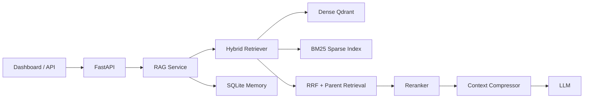
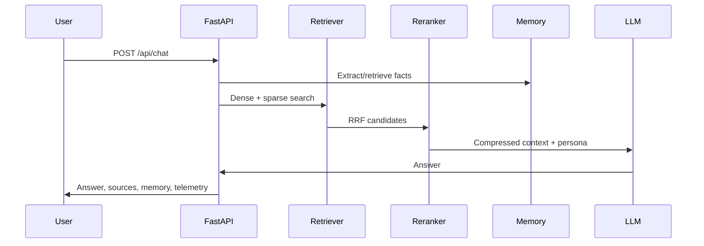

# NeuroRAG

NeuroRAG is a local-first advanced RAG application that combines dense vector retrieval, BM25 sparse retrieval, reciprocal rank fusion, parent-document retrieval, reranking, context compression, semantic memory, and persona adaptation.

## Features

- FastAPI backend and Swagger UI
- Hybrid dense + sparse retrieval
- Persistent local Qdrant storage
- Parent/child chunk retrieval
- RRF document fusion
- Cohere reranking with a deterministic local fallback
- SQLite semantic memory
- Python/response-style persona adaptation
- Real latency telemetry
- PDF and TXT ingestion
- Premium responsive dashboard
- Automated pytest coverage
- Postman collection

## Architecture





## Project Structure

```text
app/
  api/
  core/
  ingestion/
  retrieval/
  compression/
  memory/
  services/
  schemas/
frontend/
tests/
data/sample_documents/
storage/
scripts/
postman/
```

## Installation

Python 3.11 or newer is required.

```powershell
python -m venv .venv
.\.venv\Scripts\Activate.ps1
python -m pip install -r requirements.txt
python scripts\ingest.py
python -m uvicorn app.main:app --reload
```

Open:

- Dashboard: http://127.0.0.1:8000/
- Swagger: http://127.0.0.1:8000/docs
- Health: http://127.0.0.1:8000/health

## Local Mode

No paid credentials are required. Local mode uses:

- deterministic local embeddings
- local BM25
- persistent local Qdrant
- deterministic local reranking
- deterministic local generation
- SQLite semantic memory

External integrations activate only when credentials are configured:

| Variable | Purpose |
|---|---|
| OPENAI_API_KEY | OpenAI chat generation |
| COHERE_API_KEY | Cohere reranking |
| QDRANT_URL | Remote Qdrant URL; local mode uses on-disk storage |
| MEM0_API_KEY | Reserved for a future Mem0 adapter |
| LLM_PROVIDER | `local` or `openai` |
| EMBEDDING_PROVIDER | `local` |
| RERANK_PROVIDER | `local` or `cohere` |
| MEMORY_PROVIDER | `local` |

The `.env` file is ignored. Only `.env.example` contains placeholders.

## Retrieval Details

- Dense embeddings use a deterministic hashed local vector and persistent Qdrant.
- BM25 indexes child chunks.
- RRF combines ranked lists using `1 / (60 + rank)`.
- Parent-document retrieval returns the full parent for matched children.
- Cohere uses `rerank-english-v3.0` when configured; otherwise a clearly labeled local reranker is used.
- Context is truncated to a configurable character budget.

## Persona Memory Workflow

First turn:

```json
{
  "query": "Hello! I work in Python and prefer brief, code-only responses.",
  "user_id": "usr_99",
  "session_id": "session_001"
}
```

Retrieve it with:

```text
GET /api/users/usr_99/memories
```

Second turn:

```json
{
  "query": "Write a quick merge sort routine.",
  "user_id": "usr_99",
  "session_id": "session_002"
}
```

The local generator returns a concise Python merge sort in a code block.

## Testing

```powershell
python -m pytest
python scripts\ingest.py
```

## Postman

Import `postman/neurorag_collection.json` in Postman and set `baseUrl` if needed. It includes health, chat, memories, document listing, text ingestion, and upload requests.

## API

- `GET /health`
- `GET /api/status`
- `POST /api/chat`
- `GET /api/users/{user_id}/memories`
- `DELETE /api/users/{user_id}/memories/{memory_id}`
- `GET /api/documents`
- `POST /api/ingest`
- `POST /api/documents/upload`
- `DELETE /api/documents/{document_id}`

## Limitations

- Local embeddings are deterministic but not semantic neural embeddings.
- Local generation is deterministic and does not substitute for a general-purpose LLM.
- Cohere/OpenAI/Mem0 integrations require credentials and are not verified without them.
- Remote Qdrant is currently not automatically activated by `QDRANT_URL`; local persistent Qdrant is used.
